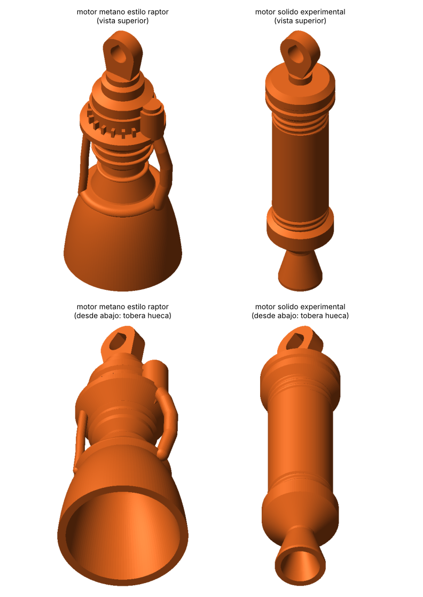

# Llaveros 3D: motores de cohete experimentales 🚀

Dos llaveros **redondos en 3D completo** para imprimir en una **Creality (FDM) con PLA**, sin soportes.



| Archivo (`stl/`) | Motor | Tamaño (Ø × alto) | PLA aprox.* |
|---|---|---|---|
| `llavero_motor_solido_experimental.stl` | Motor de propelente sólido de prueba estática: tobera convergente-divergente, retenedor, roscas, cámara, tapón y sellante con ignitor | 15 × 66 mm | ~5 g |
| `llavero_motor_metano_estilo_raptor.stl` | Motor de metano de combustión por etapas (inspirado en el Raptor 1): campana, colector regenerativo, cámara con anillos, brida, inyectores, 2 turbobombas y 2 tuberías | 25 × 60 mm | ~5,5 g |

\*Con 3–4 paredes y 20 % de relleno. Macizos pesan unos 7,4 y 7,9 g.

## Ingeniería de imprimibilidad
Se imprimen **de pie**, con la salida de la tobera sobre la cama y la anilla arriba.
- **Tobera hueca, como la real.** La cavidad se estrecha al subir (semiángulo ≤ 44°), así que se sostiene sola.
- **Sin voladizos de más de 45°.** Hay chaflanes a 45° bajo el tapón, la brida y el retenedor. Los anillos tienen perfil de "gota", las turbobombas tienen base cónica y las tuberías son casi verticales (≤ 25°).
- **Rosca helicoidal senoidal** r(θ,z) = R₀ + e·cos(θ − 2πz/P). La pendiente máxima del flanco es 2πe/P. Con P = 1,5 mm y e = 0,22 mm sale ≈ 43°, así que no necesita soporte.
- **Agujero de la anilla en forma de gota** (punta arriba). Se imprime horizontal sin soporte y admite una anilla partida (Ø 4 mm).
- **Mallas validadas.** Son estancas (*watertight*) y de 1 cuerpo. El género topológico cuadra con el diseño: 1 en el motor sólido (anilla) y 3 en el Raptor (anilla + 2 tuberías). Superficie con voladizo mayor de 50°: 0,3 mm² y 3 mm².

## Ajustes recomendados (Creality Print / Cura / OrcaSlicer)
| Parámetro | Valor |
|---|---|
| Capa | **0,12 mm** (detalle de roscas y anillos); 0,16 mm como mínimo |
| Paredes | 3–4 |
| Relleno | 20 % giroide |
| Temperatura | 200–210 °C boquilla · 60 °C cama |
| Ventilador | 100 % desde la capa 3 |
| Soportes | **Ninguno** |
| Adhesión | **Borde (brim) de 4–5 mm**: la base es un anillo fino (tobera hueca) y la pieza es alta |
| Velocidad | Baja (≤ 40 mm/s), o "tiempo mínimo de capa" ≥ 8 s, porque las capas superiores son pequeñas |

> Consejo: imprime 2 o 3 a la vez, separados en la cama. Así cada capa tiene tiempo de enfriarse y el detalle superior sale más nítido.

## Modificar / regenerar
Todo es paramétrico: radios de garganta y salida, paso de rosca, tamaño de la anilla, etc.
```bash
pip install manifold3d trimesh numpy matplotlib
python3 generar_llaveros.py   # escribe stl/*.stl y muestra medidas, masa y validación
python3 render_preview.py     # regenera preview.png
```
Para hacerlos más pequeños, escálalos en el slicer (p. ej. al 80 %). La pared de la tobera mide 1,1–1,6 mm, así que no conviene bajar del 70 %.

Los modelos anteriores de "medio relieve" (espalda plana) siguen en el historial de git (commit `Add rocket-engine keychain 3D models`).
