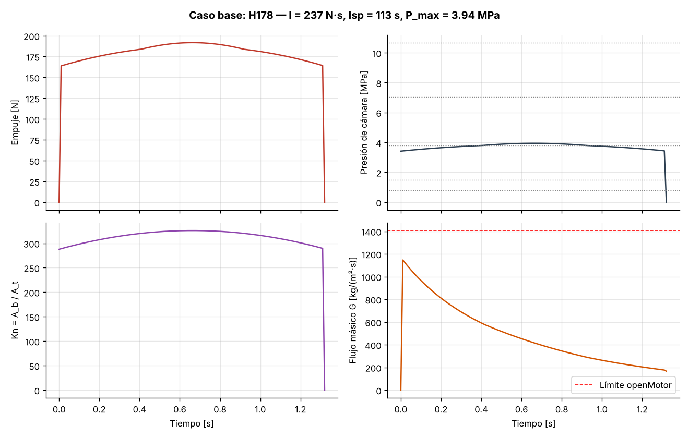
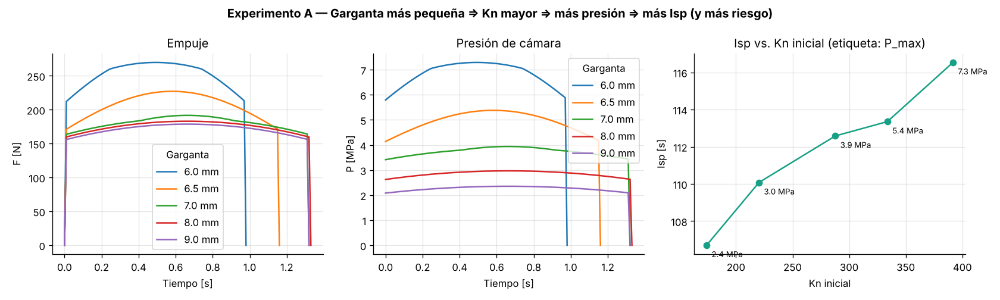
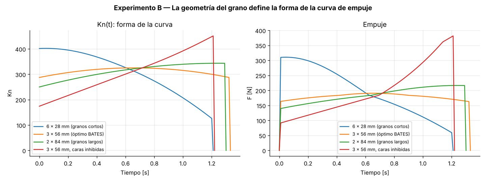
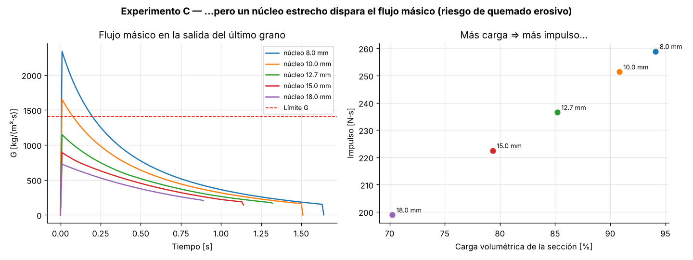

# 🚀 Aprendiendo openMotor: cómo funciona por dentro un motor cohete sólido

> **En una frase:** este material enseña a simular un motor cohete de propelente sólido con
> [openMotor](https://github.com/reilleya/openMotor) y, sobre todo, a **entender por qué** el motor
> se comporta como se comporta.

---

## 📑 Contenido

1. [¿Qué hay en esta carpeta?](#1--qué-hay-en-esta-carpeta)
2. [Cómo empezar en 2 minutos](#2--cómo-empezar-en-2-minutos)
3. [¿Qué es un motor cohete sólido?](#3--qué-es-un-motor-cohete-sólido)
4. [Vocabulario esencial](#4--vocabulario-esencial)
5. [La física, paso a paso](#5--la-física-paso-a-paso)
6. [El motor de ejemplo](#6--el-motor-de-ejemplo)
7. [Usar openMotor paso a paso](#7--usar-openmotor-paso-a-paso)
8. [Experimento A: el tamaño de la garganta](#8--experimento-a-el-tamaño-de-la-garganta)
9. [Experimento B: la forma del grano](#9--experimento-b-la-forma-del-grano)
10. [Experimento C: el diámetro del núcleo](#10--experimento-c-el-diámetro-del-núcleo)
11. [Retos para estudiantes](#11--retos-para-estudiantes)
12. [Lo que el modelo NO hace](#12--lo-que-el-modelo-no-hace)
13. [Plan de clase sugerido](#13--plan-de-clase-sugerido)

---

## 1. 📂 ¿Qué hay en esta carpeta?

```
ensenanza-openmotor/
├── README.md                 ← esta guía (empieza aquí)
├── mini_openmotor.py         ← el modelo físico, explicado línea por línea
├── practica_openmotor.py     ← simula el motor de ejemplo y 3 experimentos
└── resultados/               ← todo lo que genera el script
    ├── 01_caso_base.png          gráficas del motor de ejemplo
    ├── 02_barrido_garganta.png   experimento A
    ├── 03_geometria_bates.png    experimento B
    ├── 04_densidad_carga.png     experimento C
    ├── motor_base.ric            el motor, para abrir en openMotor
    ├── motor_base.eng            curva de empuje, para OpenRocket
    └── motor_base.csv            datos numéricos, para Excel o Python
```

| Archivo | ¿Para qué sirve? | ¿Quién lo usa? |
|---|---|---|
| `README.md` | Explicar la teoría y guiar la clase | Docente y estudiantes |
| `mini_openmotor.py` | Ver las ecuaciones que openMotor usa por dentro | Quien quiera entender el "motor" del programa |
| `practica_openmotor.py` | Generar automáticamente todas las gráficas | Docente, para preparar la clase |
| `motor_base.ric` | Abrir el ejemplo en openMotor sin escribir nada a mano | Estudiantes |

---

## 2. ⚡ Cómo empezar en 2 minutos

**Opción 1: solo quiero ver el ejemplo en openMotor**

1. Descarga e instala openMotor desde su página de
   [Releases](https://github.com/reilleya/openMotor/releases).
2. Abre el programa y entra a **File ▸ Open**.
3. Selecciona `resultados/motor_base.ric`.

**Opción 2: quiero generar las gráficas yo misma**

```bash
pip install numpy scipy matplotlib
python3 practica_openmotor.py
```

En unos 4 segundos imprime los resultados en pantalla y guarda todo en `resultados/`.

---

## 3. 🔥 ¿Qué es un motor cohete sólido?

Es básicamente **un tubo con combustible sólido dentro y un agujero estrecho en un extremo**.

```
   CIERRE        GRANOS DE PROPELENTE (sólido)              TOBERA
  ┌──────┬───────────┬───────────┬───────────┬───────╲
  │      │███████████│███████████│███████████│        ╲___________
  │      │           │           │           │  ══►     ══►  ══►     gases
  │      │  núcleo   │  núcleo   │  núcleo   │ garganta    salida  →  calientes
  │      │███████████│███████████│███████████│        ╱‾‾‾‾‾‾‾‾‾‾‾
  └──────┴───────────┴───────────┴───────────┴───────╱
         └────────── CÁMARA DE COMBUSTIÓN ───────────┘
```

**¿Qué pasa cuando se enciende?**

1. 🔥 El propelente **se quema por sus superficies expuestas**: el agujero central (el **núcleo**)
   y las caras de cada grano.
2. 💨 La combustión produce **mucho gas caliente** dentro de la cámara.
3. 📈 Ese gas solo puede salir por la **garganta**, el punto más estrecho de la tobera. Como sale con
   dificultad, la **presión sube**.
4. 🚀 La tobera **acelera** los gases hacia atrás a velocidad supersónica. Por acción y reacción, el
   motor es empujado hacia adelante: eso es el **empuje**.
5. ⏱️ A medida que se quema, el grano cambia de forma. Por eso **el empuje cambia con el tiempo**.

> 💡 **La pregunta central del diseño:** si cambio la forma del grano o el tamaño de la garganta,
> ¿cómo cambia la curva de empuje? Eso es exactamente lo que openMotor calcula.

---

## 4. 📖 Vocabulario esencial

| Término | Símbolo | Qué significa, en palabras simples | Unidad |
|---|---|---|---|
| **Grano** | — | Cada bloque de propelente sólido. Este ejemplo usa 3. | — |
| **BATES** | — | El tipo de grano más común: un cilindro con un agujero redondo en el centro. | — |
| **Núcleo** | d | El agujero central del grano. Por ahí fluyen los gases. | mm |
| **Web** (alma) | — | El espesor de propelente que queda por quemar. Cuando llega a cero, el grano se acaba. | mm |
| **Garganta** | Dₜ, Aₜ | La parte más estrecha de la tobera. Controla cuánto gas puede salir. | mm |
| **Superficie de quemado** | A_b | El área total de propelente que está ardiendo en un instante. | m² |
| **Kn** | Kn | **La relación entre el área que quema y el área de la garganta.** Es el número más importante del diseño. | — |
| **Presión de cámara** | P_c | La presión del gas dentro del motor. | MPa |
| **Tasa de quemado** | ṙ | Qué tan rápido "retrocede" la superficie del propelente. | mm/s |
| **Empuje** | F | La fuerza que produce el motor. | N |
| **Impulso total** | I | Empuje acumulado durante todo el quemado (el área bajo la curva). | N·s |
| **Isp** (impulso específico) | Isp | Eficiencia: cuánto impulso da cada kilogramo de propelente. Es como el "rendimiento por litro" de un carro. | s |
| **Clase del motor** | H, I, J… | Categoría según el impulso total. Cada letra **duplica** la anterior (H: 160–320 N·s). | — |
| **Flujo másico** | G | Cuánto gas pasa por cada m² del núcleo por segundo. Si es muy alto, el grano se erosiona. | kg/(m²·s) |

**Lectura de la designación de un motor**, por ejemplo **H178**:

- **H** es la clase. Su impulso total está entre 160 y 320 N·s.
- **178** es el empuje promedio, en newtons.

---

## 5. 🧮 La física, paso a paso

Todo el comportamiento del motor se explica con **una cadena de cuatro eslabones**:

```
  ┌────────────┐      ┌──────────┐      ┌───────────┐      ┌──────────┐
  │ GEOMETRÍA  │ ───► │    Kn    │ ───► │  PRESIÓN  │ ───► │  EMPUJE  │
  │ del grano  │      │ A_b / Aₜ │      │    P_c    │      │    F     │
  └────────────┘      └──────────┘      └───────────┘      └──────────┘
        ▲                                     │
        └──── la presión decide qué tan ──────┘
              rápido se quema el grano
```

### Eslabón 1: ¿qué tan rápido se quema el propelente?

$$\dot r = a \cdot P_c^{\,n}$$

| Símbolo | Significado |
|---|---|
| ṙ | Velocidad a la que retrocede la superficie (m/s) |
| P_c | Presión en la cámara (Pa) |
| a, n | Constantes del propelente, que se miden en el laboratorio |

**En palabras:** a mayor presión, el propelente se quema más rápido. El exponente **n** dice
*cuánto* influye la presión:

- **n ≈ 0**: la presión casi no importa; el propelente se quema siempre a la misma velocidad.
- **n ≈ 0.5**: la presión importa bastante.
- **n → 1**: ⚠️ el motor se vuelve inestable y puede explotar.

> 🔎 El KNSB no tiene un solo valor de (a, n). Tiene **5 tramos**, uno para cada rango de presión.
> Entre 1.5 y 3.8 MPa su n es casi cero. A eso se le llama **"plateau"** y lo veremos en el
> Experimento A.

### Eslabón 2: el número Kn

$$K_n = \frac{A_b}{A_t} = \frac{\text{área de propelente que está quemando}}{\text{área de la garganta}}$$

**En palabras:** compara **cuánto gas se produce** (proporcional a A_b) con **por dónde puede salir**
(Aₜ).

- Kn grande: se produce mucho gas y sale por un agujero pequeño, así que **presión alta**.
- Kn pequeño: poco gas y un agujero grande, así que **presión baja**.

Para propelentes tipo "caramelo" como el KNSB, los valores típicos de Kn están entre 150 y 400.

### Eslabón 3: de Kn a la presión

La presión se estabiliza cuando **el gas que se produce es igual al gas que sale**:

$$\underbrace{\rho_p \, A_b \, a \, P_c^{\,n}}_{\text{gas que se produce}} \;=\; \underbrace{\frac{P_c \, A_t}{c^*}}_{\text{gas que sale}}$$

Despejando la presión se obtiene **la ecuación más importante de toda la guía**:

$$\boxed{P_c = \left(K_n \cdot \rho_p \cdot a \cdot c^*\right)^{\frac{1}{1-n}}}$$

| Símbolo | Significado |
|---|---|
| ρ_p | Densidad del propelente (kg/m³) |
| c* | "Velocidad característica": mide qué tan energéticos son los gases. Depende solo del propelente. |

> ⚠️ **Fíjate en el exponente 1/(1−n).** Con n = 0.5 vale 2, así que un 10 % más de Kn produce
> **un 21 % más de presión**. La presión es muy sensible a Kn. Por eso un error pequeño en la
> garganta puede romper la carcasa.

<details>
<summary>📐 ¿De dónde sale c*? (clic para ver)</summary>

$$c^* = \frac{\sqrt{\gamma \, \frac{R_u}{M} \, T_c}}{\gamma\sqrt{\left(\frac{2}{\gamma+1}\right)^{\frac{\gamma+1}{\gamma-1}}}}$$

- γ: razón de calores específicos de los gases (para el KNSB vale 1.136).
- R_u = 8314 J/(kmol·K): constante universal de los gases.
- M: masa molar de los gases (para el KNSB, 39.9 g/mol).
- T_c: temperatura de combustión (para el KNSB, 1520 K).

Gases **más calientes y más livianos** dan un c* mayor, y con él un motor más eficiente.
</details>

### Eslabón 4: de la presión al empuje

$$F = C_F \cdot A_t \cdot P_c$$

**En palabras:** el empuje es la presión multiplicada por el área de la garganta y por un
"factor de amplificación" de la tobera, el **coeficiente de empuje C_F** (típicamente entre 1.2 y
1.6). Una tobera bien diseñada convierte la presión en velocidad de forma eficiente.

<details>
<summary>📐 Fórmula completa de C_F y pérdidas (clic para ver)</summary>

$$C_F = \sqrt{\frac{2\gamma^2}{\gamma-1}\left(\frac{2}{\gamma+1}\right)^{\frac{\gamma+1}{\gamma-1}}\left[1-\left(\frac{P_e}{P_c}\right)^{\frac{\gamma-1}{\gamma}}\right]} \;+\; \frac{(P_e-P_a)\,A_e}{P_c\,A_t}$$

- El primer término es el **empuje por momento** (los gases que salen rápido).
- El segundo es el **empuje por presión** (la diferencia entre la presión de salida P_e y la del ambiente P_a).

openMotor multiplica C_F por cuatro factores de pérdida reales:

1. **Divergencia** de la tobera: (1 + cos α)/2.
2. **Longitud de la garganta.**
3. **Fricción** con las paredes: 0.99.
4. La **eficiencia** que ingresa el usuario (0.85 en el ejemplo).
</details>

### 🔁 El algoritmo: así "piensa" openMotor

openMotor repite este ciclo cada 0.01 s hasta que se acaba el propelente:

| Paso | Qué hace | Ecuación |
|:---:|---|---|
| 1️⃣ | Con la presión actual, calcula cuánto retrocede la superficie | Δx = a·Pⁿ·Δt |
| 2️⃣ | Con la nueva geometría, calcula el área que quema y Kn | Kn = A_b(x)/Aₜ |
| 3️⃣ | Con Kn, calcula la nueva presión | P = (Kn·ρ·a·c*)^(1/(1−n)) |
| 4️⃣ | Con la presión, calcula el empuje | F = C_F·Aₜ·P |
| 🔁 | Vuelve al paso 1 | |

Este mismo ciclo está escrito en `mini_openmotor.py`, en el método `Motor.simular()`.

---

## 6. 🎯 El motor de ejemplo

### Diseño

| Componente | Valor | Comentario |
|---|---|---|
| **Propelente** | KNSB (65 % nitrato de potasio + 35 % sorbitol) | El clásico propelente educativo, con datos de Richard Nakka. Es el preset "Nakka - KNSB" de openMotor. |
| **Granos** | 3 × BATES | |
| ↳ diámetro exterior | 33 mm | Cabe en una carcasa comercial de 38 mm |
| ↳ núcleo | 12.7 mm | ½ pulgada |
| ↳ longitud | 56 mm | La longitud "óptima" (ver Experimento B) |
| **Tobera** | | |
| ↳ garganta | 7 mm | |
| ↳ salida | 19 mm | Relación de expansión de 7.4 |
| ↳ eficiencia | 0.85 | Valor realista para toberas caseras |

### Resultados

| Resultado | Valor | ¿Cómo interpretarlo? |
|---|---|---|
| **Clase** | **H178** | Motor de alta potencia de nivel 1 |
| Impulso total | 236.5 N·s | Justo a la mitad de la clase H (160–320) |
| Empuje promedio | 178 N | Equivale a sostener unos 18 kg |
| Empuje máximo | 192 N | |
| Tiempo de quemado | 1.32 s | |
| Presión máxima | 3.94 MPa | Unas 39 atmósferas; segura para una carcasa de aluminio |
| Kn inicial → máximo | 288 → 326 | Varía solo un 13 %: curva casi plana ✅ |
| Isp | 112.6 s | Típico del KNSB, que no es muy energético pero sí seguro y barato |
| Masa de propelente | 214 g | |
| Flujo másico máximo | 1147 kg/(m²·s) | Por debajo del límite de 1406 ✅ |



### 👀 Qué observar en estas gráficas

- **Empuje (arriba a la izquierda):** tiene forma de "loma" suave. Sube un poco, llega a un máximo a
  la mitad del quemado y baja. Es la firma típica de los granos BATES.
- **Presión (arriba a la derecha):** sigue la misma forma que el empuje, porque F ∝ P. Las líneas
  punteadas grises marcan dónde cambia el tramo de la ley de quemado del KNSB.
- **Kn (abajo a la izquierda):** también es una loma. **La forma de Kn decide la forma de todo lo
  demás.**
- **Flujo másico (abajo a la derecha):** es máximo al inicio, cuando el núcleo es estrecho y por él
  pasa todo el gas. Después baja porque el núcleo se ensancha.

> 🔎 **Detalle fino:** cerca de 3.8 MPa la curva de empuje muestra un pequeño quiebre. No es un
> error: en ese punto el KNSB cambia de tramo en su ley de quemado (n pasa de ≈0 a 0.52).

---

## 7. 🖥️ Usar openMotor paso a paso

### Paso 1: instalar

Descarga el instalador para tu sistema desde
[github.com/reilleya/openMotor/releases](https://github.com/reilleya/openMotor/releases).

### Paso 2: configurar unidades (¡importante!)

openMotor viene en **unidades imperiales** (pulgadas, psi, libras).

**Edit ▸ Preferences ▸ Units** y cambia a:

| Magnitud | Unidad recomendada |
|---|---|
| Longitud | mm |
| Presión | MPa |
| Fuerza | N |
| Masa | kg o g |

### Paso 3: elegir el propelente

En el panel del motor, en el menú **Propellant**, elige **Nakka - KNSB**.

> 💡 Para la clase: abre **Edit ▸ Propellants** y muestra los 5 tramos de (a, n). Pregunta por qué
> el valor de n cambia tanto entre tramos.

### Paso 4: agregar los granos

1. Clic en **Add Grain** y elige **BATES**.
2. Escribe: Diameter = 33 mm, Core Diameter = 12.7 mm, Length = 56 mm.
3. Deja **Inhibited Ends** en *Neither*: ninguna cara está cubierta, así que las dos queman.
4. Usa **Copy** dos veces para tener **3 granos** iguales.

### Paso 5: configurar la tobera

| Campo en openMotor | Valor |
|---|---|
| Throat Diameter | 7 mm |
| Exit Diameter | 19 mm |
| Efficiency | 0.85 |
| Divergence Half Angle | 12° |
| Convergence Half Angle | 35° |
| Throat Length | 3 mm |

### Paso 6: simular

Pulsa **Run Simulation**. O, si prefieres, abre directamente `resultados/motor_base.ric`.

### Paso 7: leer los resultados

| Zona de la pantalla | Qué muestra |
|---|---|
| Gráfica central | Empuje, presión y Kn en función del tiempo |
| Panel de estadísticas | Designación, impulso, Isp, presión máxima… |
| **Alertas** 🔴🟡 | Avisos de presión excesiva, flujo másico alto, etc. **¡Siempre revisarlas!** |

### Paso 8: ver cómo se quema el grano

En el editor de un grano, la vista lateral muestra **contornos de quemado**: cómo retrocede la
superficie con el tiempo. Cambia el tipo a *Finocyl* o *Star* para ver geometrías más complejas.
openMotor las calcula con un método numérico llamado *fast marching*.

### Paso 9: exportar a OpenRocket

**File ▸ Export ▸ ENG**. Luego, en OpenRocket, carga el archivo `.eng` como un motor personalizado
para simular el vuelo completo del cohete.

### ✅ Paso 10: validar

Compara el panel de estadísticas de openMotor con la tabla de la [sección 6](#6--el-motor-de-ejemplo).
Como los dos usan las mismas ecuaciones, **los valores deberían ser muy parecidos**. Si no lo son,
encontrar la causa es un excelente ejercicio de ingeniería.

---

## 8. 🔬 Experimento A: el tamaño de la garganta

### ❓ Pregunta

¿Qué pasa si cambio **solo** el diámetro de la garganta y dejo todo lo demás igual?

### 🧪 Qué hicimos

Probamos 5 gargantas: 6, 6.5, 7, 8 y 9 mm.

### 📊 Resultados



| Garganta | Kn inicial | Presión máx. | Isp | Tiempo de quemado | Clase | ¿Problemas? |
|:---:|:---:|:---:|:---:|:---:|:---:|---|
| 6.0 mm | 392 | **7.29 MPa** | 116.5 s | 0.98 s | H247 | ⚠️ flujo másico excesivo |
| 6.5 mm | 334 | 5.38 MPa | 113.4 s | 1.16 s | H204 | |
| **7.0 mm** | **288** | **3.94 MPa** | **112.6 s** | **1.32 s** | **H178** | ✅ caso base |
| 8.0 mm | 220 | 2.97 MPa | 110.1 s | 1.33 s | H173 | |
| 9.0 mm | 174 | 2.35 MPa | 106.7 s | 1.32 s | H169 | ⚠️ núcleo demasiado estrecho comparado con la garganta |

### 💡 Qué aprendemos

1. **Garganta más pequeña ⇒ Kn mayor ⇒ presión mayor.** Es la cadena de la sección 5 en acción.
2. **La presión es muy sensible:** con solo 1 mm menos de garganta (de 7 a 6 mm), la presión
   **casi se duplica** (de 3.9 a 7.3 MPa). La causa es el exponente 1/(1−n).
3. **Más presión ⇒ más eficiencia (Isp),** porque la tobera aprovecha mejor la expansión de los
   gases. Pero también aumentan el riesgo y el peso de la carcasa que hay que construir.
4. **Sorpresa:** entre 7 y 9 mm **el tiempo de quemado casi no cambia**. ¿Por qué? Porque esas
   presiones caen en el **plateau** del KNSB, donde n ≈ 0 y el propelente se quema a la misma
   velocidad sin importar la presión.

### 🗣️ Preguntas para discutir

- Si quieres más Isp, ¿por qué no haces la garganta lo más pequeña posible?
- ¿Qué pasaría si la garganta se **erosiona** (se agranda) durante el quemado?
- ¿Por qué el plateau es una propiedad **deseable** en un propelente?

---

## 9. 🔬 Experimento B: la forma del grano

### ❓ Pregunta

Con la **misma cantidad de propelente**, ¿puedo cambiar la forma de la curva de empuje?

### 🧪 Qué hicimos

Repartimos los mismos **168 mm de propelente** de cuatro formas distintas:

| Caso | Configuración | Idea |
|---|---|---|
| 🔵 | 6 granos de 28 mm | Granos cortos: muchas caras |
| 🟠 | 3 granos de 56 mm | La longitud "óptima" |
| 🟢 | 2 granos de 84 mm | Granos largos: mucho núcleo |
| 🔴 | 3 granos de 56 mm con caras **inhibidas** (cubiertas para que no quemen) | Solo quema el núcleo |

### 📊 Resultados



| Caso | Tipo de curva | ¿Qué domina? | Variación de Kn |
|---|---|---|:---:|
| 🔵 6 × 28 mm | 📉 **Regresiva**: el empuje baja | Las caras, que se encogen al quemarse | 64 % |
| 🟠 3 × 56 mm | ➖ **Neutra**: el empuje es casi constante | Equilibrio entre caras y núcleo | **13 %** |
| 🟢 2 × 84 mm | 📈 **Progresiva**: el empuje sube | El núcleo, que crece al quemarse | 37 % |
| 🔴 inhibidas | 📈📈 **Muy progresiva** | Solo el núcleo | 159 % |

### 💡 Qué aprendemos

En un grano BATES compiten dos superficies:

```
         CARAS (arriba y abajo)              NÚCLEO (el agujero)
         ┌─────────────────┐                ┌─────────────────┐
         │   ███████████   │                │   ███     ███   │
         │   ███     ███   │                │   ███     ███   │
         │   ███████████   │                │   ███     ███   │
         └─────────────────┘                └─────────────────┘
      se ENCOGEN al quemarse             CRECE al quemarse
      (el anillo se adelgaza)            (el agujero se ensancha)
         ⇒ empuje baja 📉                  ⇒ empuje sube 📈
```

- Si **dominan las caras** (granos cortos), la curva es **regresiva**.
- Si **domina el núcleo** (granos largos), la curva es **progresiva**.
- Si **se equilibran**, la curva es **neutra**. Esto ocurre cuando la longitud es

$$L_{\text{óptima}} = \frac{3D + d}{2} = \frac{3(33) + 12.7}{2} \approx 56 \text{ mm}$$

### ✏️ Ejercicio analítico

El área que quema en un BATES, cuando la superficie ha retrocedido una distancia x, es:

$$A_b(x) = \underbrace{\pi(d+2x)(L-2x)}_{\text{núcleo}} + \underbrace{2 \cdot \frac{\pi}{4}\left[D^2-(d+2x)^2\right]}_{\text{dos caras}}$$

**Demuestra** que si L = (3D+d)/2, el área al **inicio** (x = 0) es igual al área al **final**
(x = (D−d)/2). Esa es la condición de "máxima neutralidad".

### 🗣️ Preguntas para discutir

- ¿Para qué misión querrías una curva **regresiva**? *Pista: un despegue con mucha fuerza inicial.*
- ¿Y una **progresiva**? *Pista: el cohete pierde peso mientras quema.*

---

## 10. 🔬 Experimento C: el diámetro del núcleo

### ❓ Pregunta

Si hago el núcleo más pequeño, cabe más propelente. ¿Siempre es mejor?

### 🧪 Qué hicimos

Probamos núcleos de 8, 10, 12.7, 15 y 18 mm.

### 📊 Resultados



| Núcleo | Carga (% de la sección con propelente) | Impulso | Flujo másico máx. | ¿Seguro? |
|:---:|:---:|:---:|:---:|:---:|
| 8 mm | 94 % | **259 N·s** | 2338 kg/(m²·s) | ❌ |
| 10 mm | 91 % | 251 N·s | 1652 kg/(m²·s) | ❌ |
| **12.7 mm** | **85 %** | **237 N·s** | **1147 kg/(m²·s)** | ✅ |
| 15 mm | 79 % | 223 N·s | 892 kg/(m²·s) | ✅ |
| 18 mm | 70 % | 199 N·s | 726 kg/(m²·s) | ✅ |

### 💡 Qué aprendemos

Es un **compromiso de ingeniería** clásico:

| Núcleo pequeño | Núcleo grande |
|---|---|
| ✅ Más propelente | ❌ Menos propelente |
| ✅ Más impulso | ❌ Menos impulso |
| ❌ Todo el gas pasa por un agujero estrecho | ✅ El gas fluye con holgura |
| ❌ Riesgo de **quemado erosivo** | ✅ Sin riesgo |

**¿Qué es el quemado erosivo?** Cuando el gas pasa **muy rápido** por el núcleo, "barre" la
superficie del propelente y lo hace quemar más rápido de lo normal. Eso produce un **pico de
presión inesperado** que puede romper el motor.

> ⚠️ **openMotor NO calcula el quemado erosivo.** Solo te avisa cuando el flujo másico supera
> ~1400 kg/(m²·s). Por eso hay que respetar ese límite con margen.

### 🗣️ Pregunta de ingeniería

El núcleo de 10 mm da **6 % más de impulso**, pero supera el límite de flujo másico.
¿Lo aceptarías? ¿Qué prueba harías antes de volar ese motor?

---

## 11. 🏆 Retos para estudiantes

### Reto 1: diseño a especificación ⭐⭐

Diseña un motor que cumpla **todos** estos requisitos:

- [ ] Clase **I** (impulso entre 320 y 640 N·s)
- [ ] Carcasa de **54 mm** (diámetro de grano ≤ 49 mm)
- [ ] Presión máxima **< 5 MPa**
- [ ] **Ninguna alerta** en openMotor

Entrega el archivo `.ric` y **justifica cada decisión** que tomaste.

### Reto 2: análisis de sensibilidad ⭐⭐

Cambia en **±10 %** cada propiedad del propelente (a, n, T) y anota cómo cambian el impulso y la
presión máxima.

- ¿Cuál parámetro afecta más?
- ¿Qué te dice eso sobre **qué conviene medir con más cuidado** en el laboratorio?

### Reto 3: validación experimental ⭐⭐⭐

Si tienen acceso a un banco de pruebas estático:

1. Superpón la curva **medida** y la **simulada**.
2. Ajusta la eficiencia de la tobera y c* hasta que coincidan.
3. Discute por qué esos dos parámetros están relacionados entre sí.

### Reto 4: más allá de BATES ⭐

En openMotor, cambia el grano superior por uno tipo **Finocyl** (núcleo con aletas) de 6 aletas.

- ¿Qué le pasa al Kn inicial?
- ¿Para qué tipo de misión sería útil ese perfil?

---

## 12. ⚠️ Lo que el modelo NO hace

Todo modelo tiene límites, y un buen científico los conoce:

| Limitación | Consecuencia práctica |
|---|---|
| **No modela el encendido.** Supone que la presión aparece instantáneamente. | En las gráficas, el empuje "salta" a su valor en t = 0. En la realidad tarda unas décimas de segundo. |
| **Cámara 0D.** Supone la misma presión en todo el motor. | En motores largos, la presión real es mayor en el extremo delantero. |
| **No calcula el quemado erosivo.** | Solo avisa con el límite de flujo másico. |
| **Depende de los datos del propelente.** | Si a, n o c* están mal medidos, todo el resultado está mal. |

> 🎓 **Regla de oro:** la simulación **orienta** el diseño, pero **solo un ensayo estático lo
> valida**.

---

## 13. 🗓️ Plan de clase sugerido

| # | Actividad | Duración | Material |
|:---:|---|:---:|---|
| 1 | **Motivación:** mostrar la gráfica del caso base y preguntar "¿de qué depende esta forma?" | 10 min | Sección 6 |
| 2 | **Teoría:** la cadena geometría → Kn → presión → empuje | 20 min | Sección 5 |
| 3 | **Práctica guiada:** construir el motor en openMotor | 30 min | Sección 7 |
| 4 | **Validación:** comparar con los resultados de esta guía | 10 min | Sección 7, paso 10 |
| 5 | **Exploración:** los estudiantes repiten los experimentos A, B y C | 30 min | Secciones 8–10 |
| 6 | **Tarea:** Reto 1 | — | Sección 11 |

---

## 📚 Referencias

- **openMotor**, código fuente: [github.com/reilleya/openMotor](https://github.com/reilleya/openMotor),
  archivos `motorlib/motor.py`, `propellant.py` y `nozzle.py`.
- **Richard Nakka**, *Richard Nakka's Experimental Rocketry Web Site*: datos experimentales del KNSB.
- **Sutton, G. P. y Biblarz, O.**, *Rocket Propulsion Elements*, capítulos 3 (toberas), 12 y 13
  (motores sólidos).
